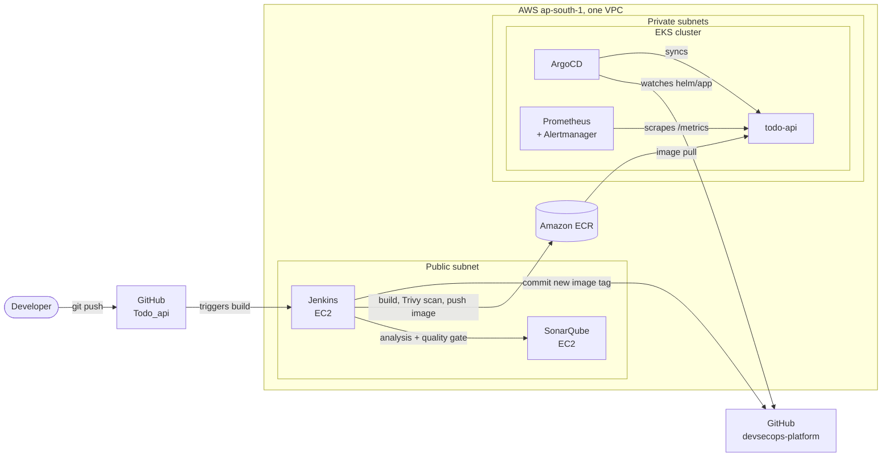

# DevSecOps Platform on AWS

An end-to-end CI/CD and observability platform on AWS. A code push is built, tested, scanned, pushed to a registry and deployed to Kubernetes through GitOps, with security gates at every stage and Prometheus alerting on service-level objectives.

This repo holds the **infrastructure, deployment and operations** code. The application and its pipeline live in the companion repo: [`Todo_api`](https://github.com/shedageabhi21/Todo_api).

## Architecture



**Delivery flow**

1. A push to `Todo_api` starts a Jenkins pipeline.
2. Jenkins runs lint, `npm audit`, unit tests, a SonarQube scan and a quality gate.
3. Jenkins builds the Docker image and scans it with Trivy. The build fails on fixable HIGH or CRITICAL findings.
4. The image is pushed to ECR, tagged with the commit SHA.
5. Jenkins commits the new tag to `helm/app/values.yaml` in this repo.
6. ArgoCD detects the change and rolls out the new version to EKS. No one runs `kubectl apply` for the app.

## Tech stack

| Area | Tools |
|---|---|
| Cloud | AWS: VPC, EC2, ECR, EKS, IAM, S3 |
| Infrastructure as code | Terraform (community `vpc`, `eks` and IAM modules, S3 remote state with native locking) |
| CI | Jenkins (pipeline as code), GitHub |
| Code quality and security | SonarQube Community Build, `npm audit`, Trivy |
| Containers | Docker (multi-stage, non-root), Amazon ECR |
| Orchestration and GitOps | Kubernetes (EKS), Helm, ArgoCD |
| Observability | Prometheus, Alertmanager, kube-prometheus-stack |
| SRE practice | SLOs and error budget, alert rules, runbook, game-day postmortem |

## Repository layout

```
devsecops-platform/
├── terraform/
│   ├── backend/        S3 bucket for Terraform state (versioned, encrypted)
│   ├── foundation/     VPC, ECR repository, Jenkins and SonarQube servers
│   └── eks/            EKS cluster, node group, EBS CSI driver (reads VPC from foundation state)
├── helm/app/           Helm chart for the application; Jenkins updates the image tag here
├── argocd/             ArgoCD Application that watches helm/app
├── monitoring/         kube-prometheus-stack values and alert rules
└── docs/               decisions, SLOs, runbook, postmortem, troubleshooting, manual setup notes
```

Each Terraform folder is a separate stack with its own state. The EKS cluster can be destroyed and rebuilt without touching the VPC, the registry or the CI servers.

## Security controls

| Layer | Control |
|---|---|
| Network | SSH, Jenkins and SonarQube are reachable only from an allow-listed CIDR. The Kubernetes API endpoint is restricted to the same range. EKS nodes sit in private subnets. |
| Identity | Jenkins pushes to ECR through an EC2 instance role, so no AWS keys are stored anywhere. The EBS CSI driver uses IRSA (a role scoped to one service account). |
| Compute | IMDSv2 enforced, encrypted EBS volumes, no root account use. |
| State | Terraform state in a versioned, encrypted S3 bucket with public access blocked. |
| Pipeline | Quality gate (SonarQube), dependency audit (`npm audit`), image scan (Trivy). Any of them can stop a release. |
| Container | Multi-stage build, non-root user, npm removed from the runtime image, pinned Node major version. |
| Kubernetes | Non-root pod, read-only root filesystem, all Linux capabilities dropped, resource requests and limits, liveness and readiness probes. |
| Delivery | Git is the only way to change the app in the cluster. ArgoCD self-heal reverts manual changes. Images are tagged by commit SHA. |
| Secrets | No secrets in either repo. Tokens live in the Jenkins credential store. `.tfvars` and state files are git-ignored. |

## Observability and SRE

The app exposes `/health`, `/ready` and `/metrics` (request count and latency by route). Prometheus scrapes it through a `ServiceMonitor`.

| Alert | Condition |
|---|---|
| `TodoApiDown` | No healthy target for 1 minute |
| `TodoApiHighErrorRate` | More than 5% of requests return 5xx for 5 minutes |
| `TodoApiHighLatency` | p95 latency above 500 ms for 5 minutes |

- Objectives and error budget policy: [`docs/SLOs.md`](docs/SLOs.md)
- Response procedures: [`docs/runbook.md`](docs/runbook.md)
- Controlled failure tests (pod kill, bad image tag, alert firing): [`docs/postmortem.md`](docs/postmortem.md)

## Deploy from scratch

Prerequisites: an AWS account, AWS CLI with a profile, Terraform 1.10 or newer, kubectl, Helm, an EC2 key pair in `ap-south-1`.

```bash
# 1. Remote state bucket
cd terraform/backend && terraform init && terraform apply

# 2. Network, registry and CI servers
cd ../foundation
cp terraform.tfvars.example terraform.tfvars      # set my_ip (CIDR) and key_name
terraform init && terraform apply

# 3. Install and configure SonarQube and Jenkins on the two servers
#    follow docs/manual-tools-setup.md, then run the Todo_api pipeline

# 4. Kubernetes cluster
cd ../eks
cp terraform.tfvars.example terraform.tfvars      # set cluster_version and my_ip
terraform init && terraform apply
aws eks update-kubeconfig --region ap-south-1 --name devsecops-eks

# 5. GitOps and monitoring
kubectl create namespace argocd
kubectl apply -n argocd --server-side --force-conflicts -f <ArgoCD install manifest, pinned version>
kubectl apply -f argocd/application.yaml
helm upgrade --install monitoring prometheus-community/kube-prometheus-stack \
  -n monitoring --create-namespace -f monitoring/values.yaml --version <pinned chart version>
kubectl apply -f monitoring/alert-rules.yaml
```

Reach the UIs with port-forwards, for example `kubectl port-forward svc/argocd-server -n argocd 8080:443`. Nothing is exposed publicly except the allow-listed tool servers.

## Cost and teardown

The EKS control plane, the two worker nodes, the two EC2 servers and the NAT gateway all bill while they exist. Keep a budget alert in place.

```bash
cd terraform/eks && terraform destroy          # end of each session
cd ../foundation && terraform destroy          # when the project is finished
```

Stop the two EC2 instances when idle. Their public IPs change on restart, so refresh the allow-list if your own IP changes too.

## Known limitations and next steps

| Limitation | Why | Production approach |
|---|---|---|
| Todos are stored in memory, so the app runs as one replica | Keeps the focus on the platform | Move to PostgreSQL, then run 2 or more replicas with a PodDisruptionBudget |
| Jenkins and SonarQube were installed by hand | Faster first run | Convert [`docs/manual-tools-setup.md`](docs/manual-tools-setup.md) into Ansible roles (planned) |
| OWASP Dependency-Check stage is disabled | The first NVD database download is slow | Re-enable with an NVD API key and a cached data directory |
| Tool servers are in public subnets behind an IP allow-list, over plain HTTP | Simple, low cost | Private subnets, SSM access, internal load balancer with HTTPS |
| No Alertmanager receiver | Alerts are visible only in the Prometheus UI | Route to Slack or PagerDuty |
| Prometheus has no persistent storage and keeps 2 days of data | Avoids orphaned volumes in a lab | Persistent volumes and longer retention |
| Grafana is installed but dashboards were not built | Browser issue on the lab VM | Add dashboards for the SLOs as code |
| One IAM role shared by both tool servers | Fewer resources | Separate least-privilege roles |
| SonarQube webhook URL validation is turned off | Both servers use private addresses | Keep it on and use internal DNS |

## Screenshots

Add images to `docs/screenshots/` and keep these file names.

| File | Shows |
|---|---|
| `pipeline-green.png` | Jenkins stage view, all stages passing |
| `sonarqube.png` | SonarQube project dashboard and quality gate |
| `trivy.png` | Trivy scan output |
| `ecr-images.png` | Image tags in ECR |
| `argocd-synced.png` | ArgoCD application, Synced and Healthy |
| `pods.png` | `kubectl get pods -n app` |
| `prometheus-targets.png` | `todo-api` target UP |
| `alert-firing.png` | `TodoApiDown` firing during the game day |


## Documentation index

| Document | Purpose |
|---|---|
| [`docs/decisions.md`](docs/decisions.md) | Why each design choice was made |
| [`docs/troubleshooting.md`](docs/troubleshooting.md) | Problems hit during the build and how they were fixed |
| [`docs/manual-tools-setup.md`](docs/manual-tools-setup.md) | Jenkins and SonarQube setup steps |
| [`docs/SLOs.md`](docs/SLOs.md) | Service level objectives and error budget |
| [`docs/runbook.md`](docs/runbook.md) | Alert response procedures |
| [`docs/postmortem.md`](docs/postmortem.md) | Game-day results |

## Author

Abhishek Shedage, DevOps Engineer. [LinkedIn](https://linkedin.com/in/abhishek-shedage-b55379202) | [GitHub](https://github.com/shedageabhi21)
